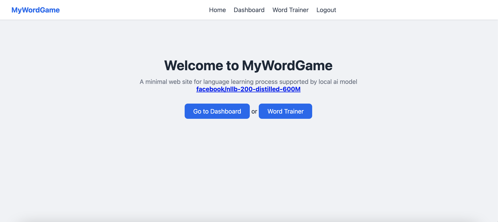

# Deutsch WordGame with Local AI

A German↔Turkish vocabulary flashcard trainer backed by a **fully local, on-device
neural machine translation** service (Meta's **NLLB-200 distilled 600M** model).
Every translation runs inside your own machine — no cloud APIs, no data leaves
the server.

Built as a Dockerized LAMP (Linux + Apache + MySQL/MariaDB + PHP) stack with a
separate Python translation service, plus a flat (no-framework) PHP web app and
an SQLite word database.

---

## Screenshot



---

## Features

- **Flashcard word trainer** — flip cards to reveal Turkish translations, filter
  by category, shuffle, and navigate with buttons or arrow keys.
- **On-the-fly AI translation** — translate any word (or example sentence) into
  one of **20 languages** while you train, using the local NLLB model.
- **100% private / offline** — the translation model runs entirely on-device via
  CTranslate2; nothing is sent to a third-party service.
- **Example sentences** — most words ship with a German↔Turkish sample sentence
  (toggleable, preference remembered in the browser).
- **User accounts** — register/login with session auth, plus an admin panel for
  managing users and roles.
- **Auto-imported vocabulary** — words are loaded from XML wordlists into SQLite
  automatically on first run.

---

## Architecture

```
┌─────────────────────────────────────────────────────────────────────┐
│                             Browser                                  │
└───────────────┬─────────────────────────────────────┬─────────────────┘
                │  HTTP (port 8080)                    │  HTTP (port 8080)
                ▼                                     ▼
        ┌────────────────┐                     ┌────────────────┐
        │  Apache + PHP  │   game.php?action  │  Apache + PHP  │
        │   web app      │   =translate       │   web app      │
        │  src/*.php     │  (curl proxy)      │  src/game.php  │
        └───────┬────────┘                     └───────┬────────┘
                │ SQLite                              │ POST /translate
                ▼                                     ▼
        ┌────────────────┐                     ┌────────────────┐
        │  data.sqlite   │                     │  FastAPI        │
        │  (words/users) │                     │  app.py         │
        │  auto-seeded   │                     │  (port 8000)    │
        │  from XML      │                     └───────┬────────┘
        └────────────────┘                             ▼
                                              ┌────────────────┐
                                              │  CTranslate2    │
                                              │  NLLB-200 600M  │
                                              │  int8 (CPU)     │
                                              └────────────────┘
```

The web front end (Apache/PHP + SQLite) and the translation backend (FastAPI +
CTranslate2) are two independent processes inside the same container. The PHP
`game.php` page acts as a **proxy**: the browser never talks to the translation
API directly — it calls PHP, which forwards the request to `localhost:8000`.

---

## Repository layout

| Path | Purpose |
|------|---------|
| `dockerfile` | Multi-stage image: converts NLLB to CTranslate2, then builds the LAMP + Python stack |
| `docker-compose.yml` | Container wiring: ports, volume, MySQL root password |
| `start.sh` | Container entrypoint: starts MySQL, the translator, then Apache |
| `app.py` | FastAPI translation service (NLLB model inference via CTranslate2) |
| `000-default.conf` | Apache virtual host (`DocumentRoot /var/www/html`) |
| `phpmyadmin.conf` | Virtual host for phpMyAdmin (`docker.phpmyadmin.dev`) |
| `php.ini` | PHP configuration |
| `src/` | Flat PHP web application (no framework, no Composer) |
| `src/db.php` | PDO singleton, schema creation, wordlist seeding |
| `src/index.php` | Home page |
| `src/login.php` / `src/register.php` / `src/logout.php` | Session authentication |
| `src/dashboard.php` | Logged-in home: profile + admin user management |
| `src/game.php` | Flashcard trainer + translation proxy |
| `src/header.php` / `src/style.css` | Shared layout & styles |
| `src/data.sqlite` | SQLite database (created/migrated automatically) |
| `src/styles/wordlists/*.xml` | German↔Turkish vocabulary data (source of truth) |

---

## How the local AI translation works

### 1. Build time — model conversion (`dockerfile`, step 1)

The Docker build runs a temporary `converter` stage that:

- Installs `ctranslate2`, `transformers`, and CPU-only `torch`.
- Converts **`facebook/nllb-200-distilled-600M`** into the optimized
  **CTranslate2** format with **int8 quantization**:
  ```
  ct2-transformers-converter --model facebook/nllb-200-distilled-600M \
    --quantization int8 --output_dir /models/nllb-600m-ct2
  ```
- Saves the matching tokenizer next to the model.

The result (a compact int8 model, ~1.2 GB total) is copied into the final image
at `/models/nllb-600m-ct2`.

### 2. Runtime — FastAPI service (`app.py`)

`start.sh` launches the service on port `8000`:

```
/opt/venv/bin/uvicorn app:app --host 0.0.0.0 --port 8000
```

`app.py` loads the CTranslate2 translator (CPU, `int8`) and the Hugging Face
tokenizer once at startup, then exposes two endpoints:

- `GET /health` → `{"status": "ok"}`
- `POST /translate` → translates one string or a batch.

Request body:

```json
{
  "text": "Hallo",            // string or array of strings
  "source": "deu_Latn",       // NLLB source language code
  "target": "tur_Latn",       // NLLB target language code
  "beam_size": 4              // optional, default 4
}
```

Response:

```json
{ "translations": ["Merhaba"] }
```

### 3. On-the-fly translation (browser → PHP → model)

When you pick a target language in the trainer, the browser calls PHP:

```
fetch('game.php?action=translate', { method: 'POST', body: JSON.stringify({...}) })
```

`game.php` validates the input, then proxies it with `curl` to
`http://localhost:8000/translate`, returning the JSON to the browser. It keeps
a per-session cache of translated strings, and guards against concurrent
re-renders with a sequence counter.

### NLLB language codes

The model speaks 200+ languages using NLLB's `script_Latn` style codes. The
trainer offers a curated set, including:

| Code | Language | Code | Language |
|------|----------|------|----------|
| `deu_Latn` | German (source) | `tur_Latn` | Turkish |
| `eng_Latn` | English | `fra_Latn` | French |
| `spa_Latn` | Spanish | `ita_Latn` | Italian |
| `rus_Cyrl` | Russian | `arb_Arab` | Arabic |
| `jpn_Jpan` | Japanese | `zho_Hans` | Chinese (Simplified) |

Direct API example (inside the container):

```bash
curl -X POST http://localhost:8000/translate \
  -H "Content-Type: application/json" \
  -d '{"text": "Hallo", "source": "deu_Latn", "target": "tur_Latn"}'
```

---

## Database & wordlists

`src/db.php` returns a **PDO singleton** to `src/data.sqlite` and, on first use:

- Creates the `users`, `words`, and `seeded_files` tables (and migrates them
  when columns change).
- Seeds a default **admin / admin123** account if no users exist.
- Loads every `*.xml` file from `src/styles/wordlists/` into the `words` table,
  tracking each file by **filename + md5 hash** in `seeded_files` — so editing
  an XML file re-imports its words on the next request.

Wordlist XML format:

```xml
<wortschatz>
  <kategorie name="Nomen">
    <eintrag>
      <deutsch>das Haus</deutsch>
      <tuerkisch>ev</tuerkisch>
      <satz>
        <deutsch>Das Haus ist groß.</deutsch>
        <tuerkisch>Ev büyük.</tuerkisch>
      </satz>
    </eintrag>
  </kategorie>
</wortschatz>
```

`deutsch` is unique; entries with sentences upsert the sentence columns, plain
entries use `INSERT OR IGNORE`.

---

## Getting started

### 1. Build and start the stack

```bash
docker build -t lamp-stack .
docker-compose up -d --build
```

Or run the image directly:

```bash
docker run -p 8080:80 -p 3307:3306 -p 8000:8000 \
  -e MYSQL_ROOT_PASSWORD=root -it lamp-stack
```

### 2. Open the app

- Web app: <http://localhost:8080>
- phpMyAdmin: <http://docker.phpmyadmin.dev:8080> — add `127.0.0.1
  docker.phpmyadmin.dev` to your hosts file
- Translation API health: <http://localhost:8000/health>

### 3. Log in

Default account: **admin / admin123** (or register a new account).

> ⚠️ Change the default admin password before exposing the server publicly.

---

## Configuration notes

- `.gitattributes` enforces LF line endings for `*.sh`, `*.conf`, `*.ini`,
  `*.py`, and `Dockerfile` (and `text=auto` for everything else) so scripts and
  configs stay portable across platforms.
- `.gitignore` excludes macOS `.DS_Store` files.

---

## Tech stack

Apache 2 · PHP 8.3 · MySQL (MariaDB) · phpMyAdmin · Python 3 · FastAPI ·
uvicorn · CTranslate2 · Hugging Face Transformers · NLLB-200 (distilled 600M,
int8) · SQLite · Docker / Docker Compose
